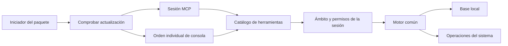

# Mapa de paridad de Mind

El código de referencia es `main` en `1181e07`, cuyo árbol coincide con el tag `v1.0.1`. Un solo Motor aplica las reglas de Mind. Cada paquete añade los runtimes y el iniciador de su sistema y arquitectura.

## Entrada, sesión y operación

1. El [iniciador](../bin/mind.js) ejecuta el Node.js del paquete. La [entrada del producto](../src/auto-update.js) comprueba el canal estable cuando corresponde, elige por sistema y arquitectura y continúa con la versión instalada si la actualización se aplaza.
2. La [sesión MCP](../src/mcp-session.js) y la [consola](../src/product-cli.js) usan el mismo [catálogo de herramientas](../src/agent-tools.js). El cliente comunica su carpeta de trabajo cuando lo admite. El [ámbito abierto](../src/workspace-access.js) y el [consentimiento](../src/consent.js) determinan el acceso. Un cliente sin formulario puede dejar una solicitud para la consola.
3. El [Motor](../src/motor.js) compone el registro de carpetas, los índices, el acceso seguro a archivos, la organización y la continuidad. La [sesión](../src/session.js) coordina el trabajo compartido y su cierre. La API administrativa queda en el anfitrión del Motor. Las [funciones](../src/session-extensions.js) usan los permisos y ejecutores del mismo Motor.
4. La Base conserva los registros, índices, continuidad y definiciones. Los archivos del usuario se abren en sus carpetas. El [actualizador](../src/commands/actualizar.js) sustituye el programa y comprueba su arranque conservando la Base.

## Fronteras con el sistema

| Frontera | Windows x64 | macOS Intel y Apple Silicon | Linux x64 y ARM64 con glibc |
|---|---|---|---|
| Paquete e inicio | ZIP, `mind.cmd` y ejecutables Windows | TAR.GZ, `./mind`, runtimes macOS y `Autorizar Mind.command` | TAR.GZ, `./mind` y runtimes Linux |
| Lectura, escritura y organización | Auxiliares con API de Windows y comprobación de reparse points | Auxiliares POSIX, con `renameatx_np` para mover sin reemplazar | Auxiliares POSIX, con `renameat2` para mover sin reemplazar |
| Observación de cambios | Observador recursivo | Observador recursivo | Observadores por directorio |
| Horarios fuera de la sesión de Mind | Programador de tareas del usuario | LaunchAgent en la sesión gráfica del usuario | Cron del usuario o temporizador `systemd --user` según disponibilidad |
| Primer arranque de una descarga | Validación del iniciador y runtimes Windows | Comprobación de cuarentena en `Runtime/` y prueba del recorrido tras la descarga | Validación de permisos de ejecución y del entorno glibc |

- [Empaquetado](../scripts/construir-paquetes.mjs) copia el mismo `Motor/` y genera el manifiesto de cada destino. Los adaptadores de arranque viven en [iniciadores](../packaging/iniciadores) y la selección de runtimes en [componentes.json](../packaging/componentes.json).
- El acceso a originales utiliza los auxiliares de [índice](../src/native_index.py), [lectura](../src/native_reader.py), [extracción](../src/native_extract.py), [creación](../src/native_writer.py), [modificación](../src/native_modifier.py) y [organización](../src/native_organizer.py). En POSIX, mover un directorio requiere soporte de renombrado seguro en el sistema de archivos. El Motor rechaza la operación si falta ese soporte.
- El [observador](../src/index-observer.js) reconcilia el índice si pierde notificaciones. Las reglas de [rutas y exclusiones](../src/paths.js) contemplan diferencias de mayúsculas y minúsculas entre sistemas. [Papelera](../src/trash.js) y [respaldo cifrado](../src/backup.js) forman parte del Motor común.
- El [programador del sistema](../src/automations/system.js) se instala con confirmación. En Linux con `systemd --user`, la ejecución depende de que la sesión de usuario siga activa, salvo que el equipo ya permita mantenerla. Los eventos de archivos se observan en la sesión de Mind.
- [Cuarentena de macOS](../src/quarantine.js) comprueba el manifiesto y las huellas de `Runtime/` antes de actuar sobre la marca de descarga de esa carpeta. El ensayo automatizado de cuarentena y la apertura real desde el navegador comprueban situaciones distintas.

## Qué significa igual en los cinco destinos

| Recorrido | Resultado que se comprueba |
|---|---|
| Inicio y conexión | El paquete extraído abre Mind con sus runtimes incluidos. Se identifica la plataforma y se exponen las mismas herramientas por MCP y consola dentro del ámbito autorizado. |
| Carpetas y permisos | Con datos ficticios, la búsqueda y lectura dan los mismos resultados para la misma carpeta. Se rechazan rutas fuera del ámbito y se mantienen las confirmaciones de borrado. |
| Cambios y continuidad | Crear, editar, mover, restaurar y detectar cambios producen el resultado esperado. Al reabrir se recuperan la continuidad y los cambios persistidos. |
| Funciones y respaldo | Las funciones respetan la autorización y sus turnos. Se crea, verifica y restaura un respaldo cifrado de una Base ficticia. La prueba del programador identifica el mecanismo disponible y sus condiciones. |
| Actualización | Un paquete posterior de la misma plataforma actualiza desde el canal firmado, conserva la identidad y el contenido de la Base y deja el programa anterior disponible si el nuevo no arranca. |
| Cierre | Al cerrar la sesión, el Motor libera observadores, auxiliares y bloqueos. Cada prueba identifica qué procesos puede inventariar en ese sistema. |

## Evidencia y pendientes

- **Observado en el código.** El [constructor](../scripts/construir-paquetes.mjs) contempla los cinco destinos. MCP y consola comparten el catálogo de herramientas. El arranque y las operaciones locales usan los adaptadores del sistema. El [firmador](../scripts/firmar-actualizacion.mjs) comprueba versión, huellas y presencia de los destinos de publicación.
- **Probado en 1.0.0-rc.1.** Los cinco paquetes pasaron 12 casos por destino. Claude Code comprobó la conexión MCP. Un cliente de prueba ejecutó las operaciones con datos y consentimiento simulados. Mac pasó también el ensayo automatizado de cuarentena. [Ejecución de la candidata](https://github.com/byaldodaniel/mind-motor/actions/runs/41369923501).
- **Probado en 1.0.1.** El paquete estable de Windows x64 se validó localmente con operaciones de producto, cierre de sesiones y actualización. Los trabajos de CI del commit consultado quedaron sin pasos ejecutados. [Notas de 1.0.1](NOTAS_1_0_1.md) · [Ejecución de CI](https://github.com/byaldodaniel/mind-motor/actions/runs/41889421410).
- **Pendiente para validar paridad.** Ejecutar las mismas pruebas del paquete y del actualizador en cada destino desde un commit común. Comprobar además el primer arranque real en macOS, los programadores nativos y los límites del inventario de procesos al cerrar. Las evidencias de la candidata y de Windows sirven de referencia para comparar los resultados.

Las pruebas existentes incluyen [producto empaquetado](../scripts/producto-12-casos.mjs), [actualización automática](../scripts/producto-actualizacion-automatica.mjs), [observación](../test/index-observer.test.js), [organización y papelera](../test/organize-agent.test.js), [funciones](../test/functions-agent.test.js), [respaldo](../test/backup.test.js) y [cierre de sesiones](../scripts/verificar-recursos.mjs).
